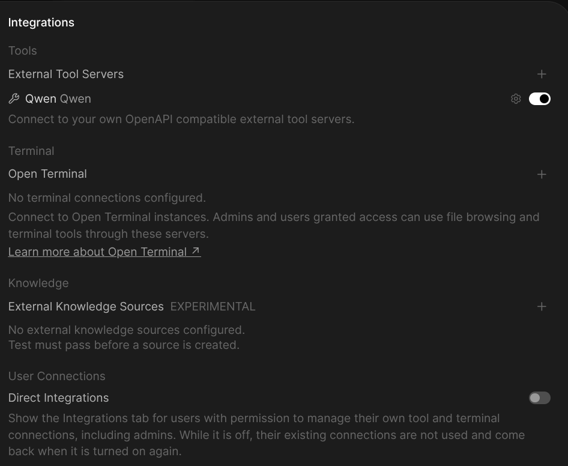
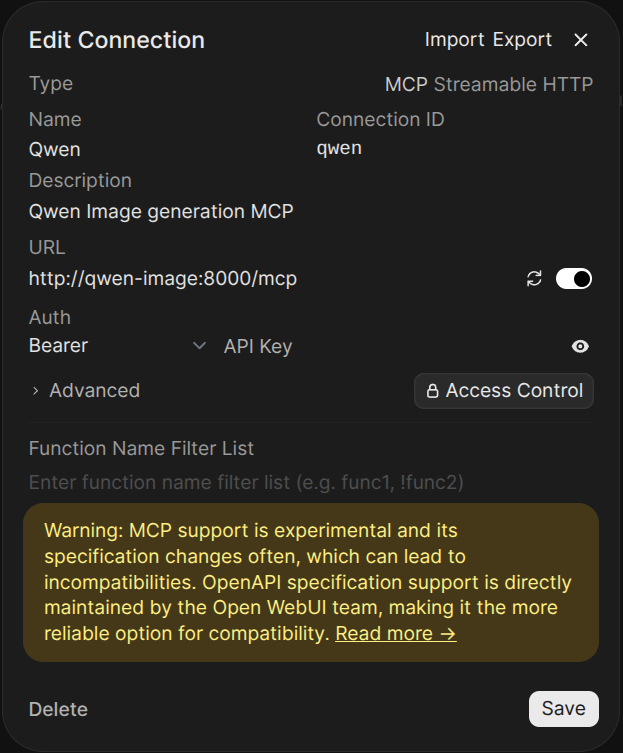
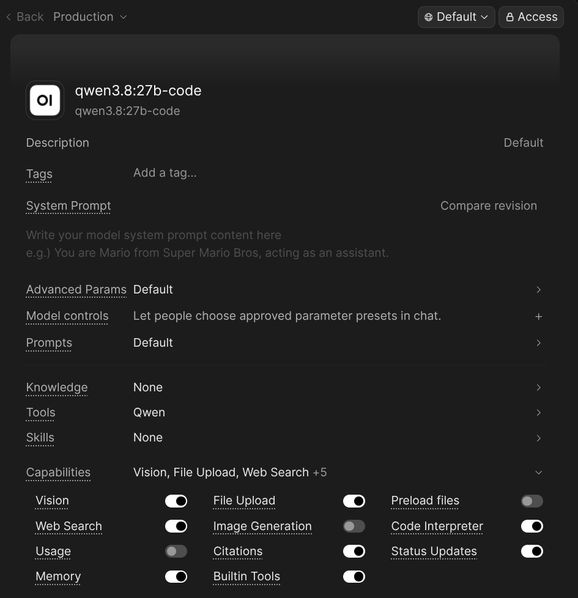

# Example generations

All three images below were produced by the **same prompt** — only the tool-call
parameters differ. This shows how `generate_image` can be parametrized:

| File | Parameters | Result |
|---|---|---|
| [cat-default-params.png](cat-default-params.png) | *(none)* | default size 1344×768, LoRA fast sampling (8 steps, cfg 1.0) — ~9 s |
| [cat-800x800.png](cat-800x800.png) | `width: 800`, `height: 800` | square crop via explicit dimensions — ~6 s |
| [cat-hq-20steps-cfg4.png](cat-hq-20steps-cfg4.png) | `steps: 20`, `cfg: 4.0` | undistilled sampling, higher fidelity & prompt adherence — ~44 s |

## Prompt

> A fluffy orange tabby cat wearing round reading glasses, sitting at a wooden
> desk with a steaming cup of coffee, soft morning window light, photorealistic,
> shallow depth of field

## Tool calls used

Each example was a single `tools/call` to the MCP endpoint (`http://qwen-image:8000/mcp`).
The arguments are shown exactly as sent:

### 1. Default parameters

```json
{
  "name": "generate_image",
  "arguments": {
    "prompt": "A fluffy orange tabby cat wearing round reading glasses, sitting at a wooden desk with a steaming cup of coffee, soft morning window light, photorealistic, shallow depth of field"
  }
}
```

Response (abridged): `1344×768`, `steps: 8`, `lora: true` — the LoRA fast-sampling
defaults kick in automatically.

### 2. Custom dimensions (`width` / `height`)

```json
{
  "name": "generate_image",
  "arguments": {
    "prompt": "…same prompt…",
    "width": 800,
    "height": 800
  }
}
```

Allowed range is 512–1536 px; the server rounds values down to multiples of 32.

### 3. Higher-quality sampling (`steps` / `cfg`)

```json
{
  "name": "generate_image",
  "arguments": {
    "prompt": "…same prompt…",
    "steps": 20,
    "cfg": 4.0
  }
}
```

Explicit `steps`/`cfg` override the LoRA defaults (8 / 1.0) and use the model's
full sampling schedule — slower, but often noticeably more faithful to the prompt.

## Setting up the connection in Open WebUI

Three screenshots walk through the setup:

**1. Add an external tool server** — *Integrations → External Tool Servers*:



**2. Point it at the MCP endpoint** — Type `MCP Streamable HTTP`, URL
`http://qwen-image:8000/mcp` (replace `qwen-image` with your container name /
host if the sidecar runs under a different name):



**3. Attach the connection to a model** — in the model's settings, set *Tools*
to your Qwen connection so its LLM can call `generate_image`:



That's it — the model now has `generate_image` and `list_images` available in chat.

## Using it in Open WebUI (or any MCP client)

You don't have to call the tool manually — just mention the parameters in your
chat message. The LLM reads the tool schema and turns your request into the
right arguments, e.g.:

| Chat message | Resulting tool call |
|---|---|
| `Draw a cat at a desk drinking coffee` | default 1344×768, LoRA sampling |
| `Draw a cat at a desk drinking coffee, square 800x800` | `width: 800, height: 800` |
| `Draw a cat at a desk drinking coffee with steps=20 cfg=4.0` | `steps: 20, cfg: 4.0` (high quality) |

Any natural phrasing works ("quadratisch", "higher quality", "16:9 banner") —
as long as the parameter name and value are clear, the client maps them to the
tool arguments shown above. The response always reports which size/steps were
actually used, so you can verify what happened.

## Reproducing these images

Any MCP client can reproduce them. With plain `curl`:

```bash
# 1. Initialize a session
SID=$(curl -si -X POST http://qwen-image:8000/mcp \
  -H 'Content-Type: application/json' \
  -H 'Accept: application/json, text/event-stream' \
  -d '{"jsonrpc":"2.0","id":1,"method":"initialize","params":{"protocolVersion":"2025-03-26","capabilities":{},"clientInfo":{"name":"example","version":"0"}}}' \
  | tr -d '\r' | grep -i '^mcp-session-id:' | awk '{print $2}')

# 2. Mark the session initialized
curl -s -X POST http://qwen-image:8000/mcp \
  -H 'Content-Type: application/json' \
  -H 'Accept: application/json, text/event-stream' \
  -H "Mcp-Session-Id: $SID" \
  -d '{"jsonrpc":"2.0","method":"notifications/initialized"}'

# 3. Generate (default parameters)
curl -s -X POST http://qwen-image:8000/mcp \
  -H 'Content-Type: application/json' \
  -H 'Accept: application/json, text/event-stream' \
  -H "Mcp-Session-Id: $SID" \
  -d '{"jsonrpc":"2.0","id":3,"method":"tools/call","params":{"name":"generate_image","arguments":{"prompt":"A fluffy orange tabby cat wearing round reading glasses, sitting at a wooden desk with a steaming cup of coffee, soft morning window light, photorealistic, shallow depth of field"}}}'
```

The response contains a `url` (e.g. `http://qwen-image:8000/images/<file>.png`)
that serves the finished image — download it directly or open it in a browser.
